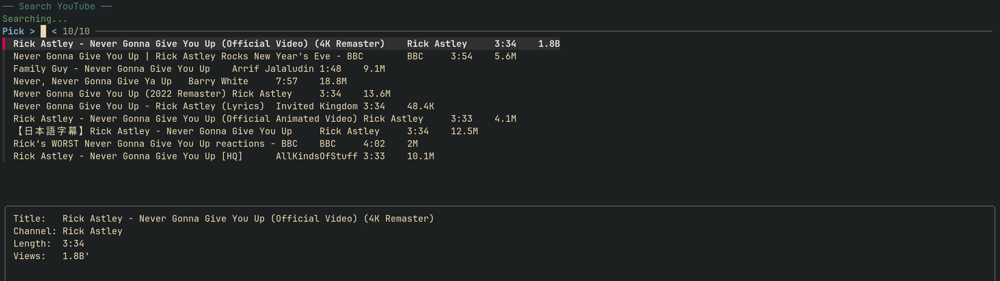

# audiofetch

Download audio from YouTube, or rewrite the metadata of existing audio files.

`audiofetch` is a Bash script that wraps `yt-dlp` and `ffmpeg` with an
interactive metadata workflow. It can search YouTube with `fzf`, clean up
common title clutter, prompt for artist/title/album, and write tags while
saving a predictable `Artist - Title (Album).ext` filename.

## Requirements

- Bash
- [`yt-dlp`](https://github.com/yt-dlp/yt-dlp)
- `ffmpeg` and `ffprobe`
- [`fzf`](https://github.com/junegunn/fzf) for interactive search

## Install

```sh
mkdir -p ~/.local/bin
ln -sf "$PWD/audiofetch" ~/.local/bin/audiofetch
```

Or run it directly:

```sh
./audiofetch --help
```

## Usage

Download from a URL:

```sh
audiofetch 'https://www.youtube.com/watch?v=...'
```

Search YouTube interactively:

```sh
audiofetch
```



Rewrite tags on existing files:

```sh
audiofetch --tag song.opus
audiofetch --tag *.opus
```

Preview tag changes without writing anything:

```sh
audiofetch --tag --dry-run song.opus
```

Show detected metadata without downloading:

```sh
audiofetch --no-download 'https://www.youtube.com/watch?v=...'
```

### Options

```text
audiofetch — Download audio or rewrite song metadata

Usage: audiofetch [options] <url>
       audiofetch [options]            Interactive YouTube search (fzf), then download
       audiofetch --tag [options] <file> [file ...]

Download mode:
  -h, --help             Show this help
  -f, --format <ext>     Audio format (opus, m4a, mp3, flac, etc.) (default: opus)
  -a, --album <name>     Override album name (e.g. "OST - Hollow Knight")
  -o, --output <dir>     Output directory (default: ~/Music)
  --no-edit              Skip metadata edit prompt
  --no-download          Only show metadata (no download)

Tag mode (rewrite a single file's metadata):
  --tag                 Interactively edit one or more files' Artist/Title/Album
  --dry-run             Show what would be done (no changes)
  --no-album            Skip album metadata

Dependencies: yt-dlp, ffmpeg, ffprobe, fzf (search mode)
```

## Notes

- YouTube changes its player client regularly. `audiofetch` passes
  `--extractor-args "youtube:player_client=mweb"` to `yt-dlp`; update
  `yt-dlp` first if downloads start failing.
- Titles are cleaned of common suffixes such as `(Official Video)`,
  `[Lyric Video]`, and `- Remastered`.
- Filenames and tags are derived from the interactive values; invalid filename
  characters are removed.
- `--tag` writes tags in place and may rename the file. Keep a backup if the
  metadata matters.

## Acknowledgements

`audiofetch` builds on excellent tools created and maintained by others:

- [`yt-dlp`](https://github.com/yt-dlp/yt-dlp) handles video search and downloads.
- [FFmpeg](https://ffmpeg.org/) (`ffmpeg` and `ffprobe`) handles audio conversion
  and metadata.
- [`fzf`](https://github.com/junegunn/fzf) provides the interactive search UI.
- [Bash](https://www.gnu.org/software/bash/) and standard Unix utilities provide
  the scripting and text-processing foundation.

This script would not have been possible without their work. Please see each
project for its own license and contribution details.

## License

MIT. The repository-wide [LICENSE](../LICENSE) applies.
