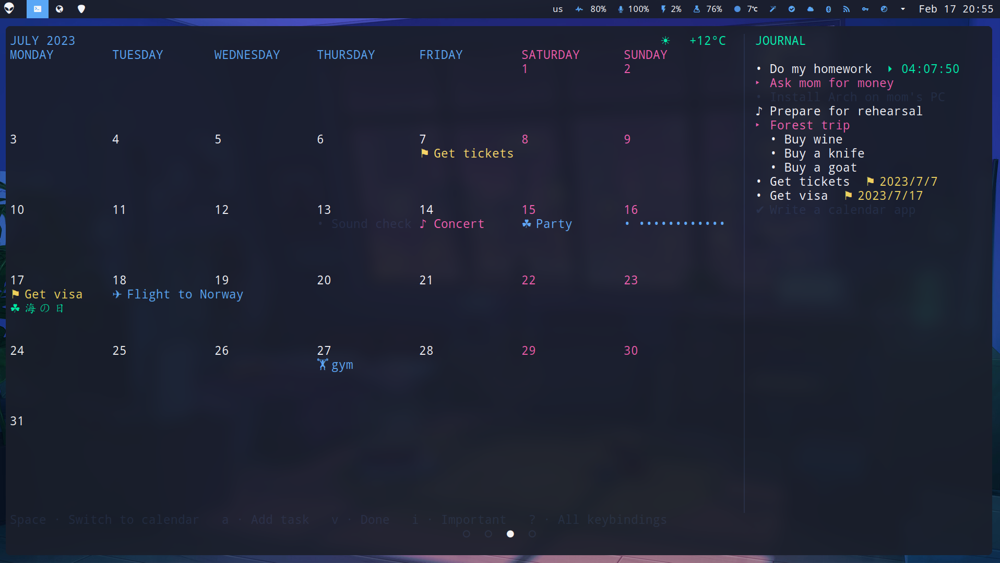

# Calcure (Fork with Two-Way Radicale CalDAV Sync & Soft TUI)

Modern terminal calendar and task manager with two-way Radicale (CalDAV) sync, curses mouse support, non-interactive Quickshell CLI flags, and a Soft TUI Base16 ANSI palette.

Forked from [Roman Anufriev's calcure](https://github.com/anufrievroman/calcure).



## Features

- **Two-Way Radicale / CalDAV Sync**: Real-time bi-directional synchronization for additions, edits, deletions, moves, and priority changes with automatic timed vs. all-day event parsing (`HH:MM` or `HH:MM-HH:MM`).
- **Curses Mouse Support**: Scroll through months or days with mouse wheel, click to select dates, double-click to toggle daily view, and click to switch between calendar and task panes.
- **Non-Interactive CLI Flags**: Fast `--json` and `--add` flags for integration with desktop shells (e.g., Quickshell), status bars (Waybar, Polybar), and notification scripts without starting the curses TUI.
- **Soft TUI Base16 Palette**: Adheres to the Soft TUI specification using standard 16-color ANSI terminal indices and transparent background (`-1`), effortlessly matching any terminal theme (Foot, Kitty, Alacritty, etc.).
- **Vim Navigation**: Full keyboard navigation with `h`/`j`/`k`/`l` or arrow keys.
- **Task & Journal Management**: Todo list with subtasks, deadlines, and timers.
- **Contact Birthdays**: Displays birthdays from your [abook](https://abook.sourceforge.io/) database.
- **Weather & Moon Phases**: Integrated optional weather forecast and lunar phases.

---

## Requirements & Dependencies

- **Python**: 3.10 or newer.
- **Python Libraries**:
  - `caldav` (for Radicale CalDAV sync)
  - `icalendar` (for RFC 5545 iCalendar serialization)
  - `holidays` (for official holiday display)
  - `windows-curses` (Windows only)

### Installation

Clone the repository and symlink the wrapper script to your `PATH`:

```sh
mkdir -p ~/.local/bin
ln -sf "$PWD/calcure/bin/calcure" ~/.local/bin/calcure
ln -sf ~/.local/bin/calcure ~/.local/bin/cal
ln -sf ~/.local/bin/calcure ~/.local/bin/calendar
```

The bundled `bin/calcure` launcher automatically resolves an available Python interpreter with `caldav`, `icalendar`, and `holidays` installed, and on NixOS will automatically build a local GC-rooted Python environment if missing.

Alternatively, install the dependencies into your system or virtual environment:

```sh
pip install caldav icalendar holidays
```

---

## Radicale (CalDAV) Two-Way Sync

`calcure` synchronizes events and tasks with any standard CalDAV server (such as [Radicale](https://radicale.org/)) or local Radicale filesystem collections.

### Configuration

Add or edit the `[radicale]` section in `~/.config/calcure/config.ini`:

```ini
[radicale]
enabled = Yes
url = http://127.0.0.1:5232/username/
username = username
password = secret
calendar = Official
```

### Environment Variables

Environment variables override `config.ini` settings:

- `RADICALE_URL`: Full CalDAV calendar collection or principal URL (e.g. `http://127.0.0.1:5232/cresol/`). Set to `"local"` to force local directory discovery.
- `RADICALE_USERNAME`: CalDAV authentication username.
- `RADICALE_PASSWORD`: CalDAV authentication password.
- `RADICALE_CALENDAR`: Target calendar name (default: `Official`).

### Local Radicale Fallback

If the remote CalDAV endpoint is unreachable, unauthenticated, or set to `"local"`, `calcure` automatically falls back to reading and writing directly to local Radicale collection directories located at:

```
~/.local/share/radicale/collections/collection-root/<username>/
```

### Timed vs. All-Day Event Handling

- **Timed Events**: Any event whose name begins with `HH:MM Title` or `HH:MM-HH:MM Title` (e.g., `10:00 Team Standup` or `14:00-15:30 Architecture Review`) is parsed into timezone-aware `DTSTART` and `DTEND` iCalendar components.
- **All-Day Events**: Events without a leading time prefix are stored as date-only `DTSTART` components.
- **Priority**: Events marked as important (`i` in the TUI) are synchronized with CalDAV `PRIORITY: 1`.
- **Privacy**: Events toggled as private (`p` in the TUI) are synchronized with CalDAV `CLASS: PRIVATE`.

---

## Mouse Support

Curses mouse interactions are enabled by default:

| Action | Result |
| --- | --- |
| **Mouse Wheel Up** | Navigate to previous month (or previous day/week in Daily/Weekly views) |
| **Mouse Wheel Down** | Navigate to next month (or next day/week in Daily/Weekly views) |
| **Left Click on Date Cell** | Select and move cursor to that day |
| **Double Click on Date Cell** | Select date and toggle directly into Daily view |
| **Left Click on Panes** | Switch active focus between Calendar and Journal/Tasks panes |

---

## Non-Interactive CLI Flags

Ideal for shell scripts, Waybar/Polybar modules, or desktop shells like Quickshell:

### 1. JSON Export (`--json`)

Outputs events for the given month as a clean JSON array:

```sh
# Current month
calcure --json

# Specific month (YYYY-MM)
calcure --json --month 2026-11
```

**JSON Output Format:**

```json
[
  {
    "uid": "beef632d-1b79-4ae7-bde6-af6f760895ed@calendula",
    "date": "2026-11-17",
    "day": 17,
    "title": "DSA CIE 2",
    "time": "11:00",
    "allDay": false,
    "important": false
  }
]
```

### 2. Fast Event Addition (`--add`)

Creates a new event and immediately writes it to local storage and Radicale without opening the TUI:

```sh
# Add an all-day event for today
calcure --add "File Taxes"

# Add an all-day event for a specific date
calcure --add "Project Milestone" --date 2026-11-20

# Add a timed event with specific hour/minute
calcure --add "Team Sync" --date 2026-11-20 --time 10:00

# Add a timed event with a duration range
calcure --add "Design Review" --date 2026-11-20 --time 14:00-15:30
```

---

## Soft TUI Base16 Color Configuration

`calcure` uses base16 ANSI indices (`0`–`15`) and `-1` for transparent terminal backgrounds, allowing the calendar to cleanly inherit your terminal's color palette:

```ini
[Colors]
color_today = 3
color_events = 7
color_days = 7
color_day_names = 8
color_weekends = 7
color_weekend_names = 8
color_hints = 8
color_prompts = 3
color_confirmations = 1
color_birthdays = 3
color_holidays = 8
color_holidays_date = 8
color_todo = 7
color_done = 8
color_title = 3
color_calendar_header = 3
color_important = 3
color_unimportant = 8
color_timer = 3
color_timer_paused = 8
color_time = 7
color_deadlines = 1
color_weather = 3
color_active_pane = 3
color_separator = 8
color_calendar_border = 8
color_frame = 8
color_foreground = 7
color_background = -1
```

---

## Keyboard Shortcuts

Press `?` at any time inside `calcure` to view the built-in help and keybindings screen.

### Navigation

- `h`, `j`, `k`, `l` or arrow keys: Move selection (day/task)
- `m`: Switch to Monthly view
- `w`: Switch to Weekly view
- `d`: Switch to Daily view
- `g`: Jump to today
- `Tab`: Switch focus between Calendar and Journal/Tasks pane

### Event Management

- `a`: Add event to selected date
- `e`: Edit selected event
- `x`: Delete selected event
- `m` / `M`: Move event to another day / month
- `i`: Toggle important status
- `p`: Toggle private status
- `r`: Reload events from storage

### Task Management

- `a`: Add a new task
- `e`: Edit selected task
- `x`: Delete selected task
- `space`: Toggle task completed (`done`)
- `s`: Add subtask
- `u`: Change task urgency/priority

---

## Running Tests

Run the unit test suite:

```sh
PYTHONPATH=calcure python3 -B -m unittest discover -s calcure/tests -v
```

All 8 unit tests cover:
- Event title truncation logic
- Hiding completed ICS tasks in calendar deadlines
- Two-way Radicale CalDAV storage and synchronization lifecycle
- Timed and all-day VEVENT serialization
- Time prefix regex parsing (`HH:MM` and `HH:MM-HH:MM`)

---

## License & Credits

- Original project by Roman Anufriev: [anufrievroman/calcure](https://github.com/anufrievroman/calcure)
- Licensed under the [MIT License](LICENSE).
